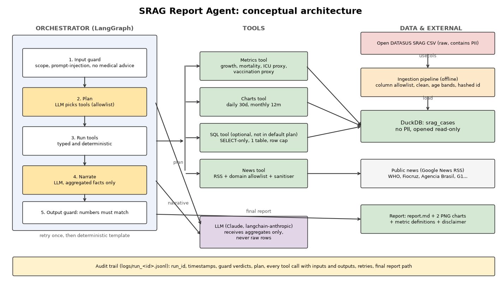

# SRAG Agent: automated surveillance report for a healthcare company (PoC)

A LangGraph agent that turns the Open DATASUS SRAG (Severe Acute Respiratory Syndrome)
hospitalisation file into a report with four metrics, two charts and live news commentary.
**The LLM never computes or sees raw data**: numbers come from deterministic SQL/Python tools, and
an output guard rejects any narrative number that is not backed by a computed value.

- Architecture diagram: [docs/architecture.pdf](docs/architecture.pdf)
- Sample report (real SRAG 2024 data, frozen snapshot of 23/03/2026): [reports/sample/report.md](reports/sample/report.md)
- Sample audit trail: [reports/sample/audit_log_example.jsonl](reports/sample/audit_log_example.jsonl)



## How to run

```bash
python -m venv .venv && source .venv/bin/activate      # Windows: .venv\Scripts\activate
pip install -e ".[dev]"
export ANTHROPIC_API_KEY=...        # or put it in a .env file; variables are listed below
srag ingest path/to/INFLUD.csv      # clean + anonymise + load into DuckDB
srag report                          # needs ANTHROPIC_API_KEY; add --offline for no LLM
pytest && ruff check src tests && mypy src
```

Download the real file from the [Open DATASUS SRAG 2019-2026 dataset](https://dadosabertos.saude.gov.br/dataset/srag-2019-a-2026),
for example (use `curl.exe` on PowerShell):
`curl -L -o data/raw/INFLUD24-23-03-2026.csv https://s3.sa-east-1.amazonaws.com/ckan.saude.gov.br/SRAG/2024/INFLUD24-23-03-2026.csv`
(about 288 MB, `;` separated, ISO timestamp dates). No data is committed to this repository. To try it without data:
`python -c "from pathlib import Path; from srag.synthetic import make_synthetic_csv; make_synthetic_csv(Path('data/demo.csv'))"`.

Environment variables: `ANTHROPIC_API_KEY`, `SRAG_MODEL` (default `claude-haiku-5-5`),
`SRAG_DB_PATH`, `SRAG_LOG_DIR`, `SRAG_REPORT_DIR`, `SRAG_HASH_SALT`.

Output: `reports/<run_id>/report.md` plus PNG charts, and `logs/run_<run_id>.jsonl`.

## Architecture and decisions

Flow (LangGraph `StateGraph`): `input guard -> plan -> run tools -> narrate -> output guard
(retry once, else template fallback) -> assemble report`.

| Decision | Why | Trade-off |
|---|---|---|
| Metrics in SQL/Python, LLM only plans and narrates | Numbers are reproducible and auditable | Less "agentic" freedom |
| LLM chooses tools from a fixed allowlist | Scope control, no arbitrary actions | The plan is simple for a PoC |
| DuckDB, opened read-only at report time | Fast on 165k rows, one file, no server | Not a multi-user store |
| `LLM` protocol over langchain-anthropic | Swappable provider, stub LLM in tests | Thin custom layer |
| Google News RSS, no API key | Reproducible setup, no key limits | Less control than a paid news API |
| Deterministic template fallback | A report is always produced, never an unchecked LLM number | Plainer prose |

## Metric definitions

All windows are anchored to the **latest event date in the data**, not to today. Event date is
symptom onset (`DT_SIN_PRI`), falling back to notification date (`DT_NOTIFIC`). The DATASUS code
`9` ("ignored") and blanks become NULL and are excluded from denominators; the report shows how
many were excluded.

| Metric | Formula | Columns |
|---|---|---|
| Case growth rate | (cases last 30 days - cases previous 30 days) / previous 30 days | `DT_SIN_PRI`, `DT_NOTIFIC` |
| Mortality rate | deaths (`EVOLUCAO` 2 or 3) / cases with known outcome, last 12 months | `EVOLUCAO` |
| ICU rate (**proxy**) | `UTI=1` / cases with known `UTI`, last 12 months | `UTI` |
| Vaccination rate (**proxy**) | `VACINA_COV=1` / cases with known value, last 12 months | `VACINA_COV` |

True ICU **occupancy** needs bed capacity and true population **vaccination coverage** needs a
population denominator. Neither is in this dataset, so the report labels both as proxies: the
share of notified SRAG hospitalisations that used ICU, and the vaccinated share among notified
cases.

## Data treatment and LGPD

- The CSV is read with a column **allowlist** (`pipeline/columns.py`), so names, CPF, CNS, birth
  date, mother's name, address and phone are never loaded, stored or logged.
- Age becomes a band (`0-4 ... 80+`) and the raw value is dropped. Geography stops at state level.
- Row identity is replaced by a salted SHA-256 hash. `data/` and `logs/` are git-ignored.
- The LLM receives only aggregated facts and sanitised news headlines. Tests assert that PII
  columns never reach the database.

## Guardrails (`guardrails.py`)

- **Input**: prompt-injection patterns, medical-advice requests and off-scope requests are refused
  before any tool runs.
- **SQL**: single read-only `SELECT`, allowlisted table, no comments or file functions, 50-row cap,
  read-only connection.
- **News**: publisher-domain allowlist, markup stripped, injection-looking headlines dropped, news
  text passed to the LLM as untrusted data.
- **Output**: every number in the narrative must match a computed value (rounding tolerance).
  A failed check triggers one retry, then the deterministic template.
- Every report ends with a disclaimer: informational only, not medical advice.

## Governance and transparency

Each run writes `logs/run_<run_id>.jsonl`: one JSON event per line with `run_id`, UTC timestamp,
and event type (`run_start`, `input_guard`, `plan`, `tool_call`, `tool_error`, `llm_narrative`,
`output_guard`, `narrative_fallback`, `report_written`, `run_end`). Tool inputs and outputs are
logged. Patient rows never appear because they never leave the database.

## Limitations

- Notification lag under-counts recent days and biases the growth rate downward.
- Mortality is in-hospital case fatality among notified cases, not population mortality.
- Vaccination and ICU values are proxies, as explained above.
- The prompt-injection and scope checks are pattern-based and can be bypassed by a determined
  attacker; the architecture limits damage because the LLM has no write or free-form data access.
- News search depends on Google News RSS availability; the report degrades gracefully without it.
- The sample report covers the 2024 file only (267,986 rows after cleaning); the news section is
  live, so headlines will differ from the sample when you re-run it.
