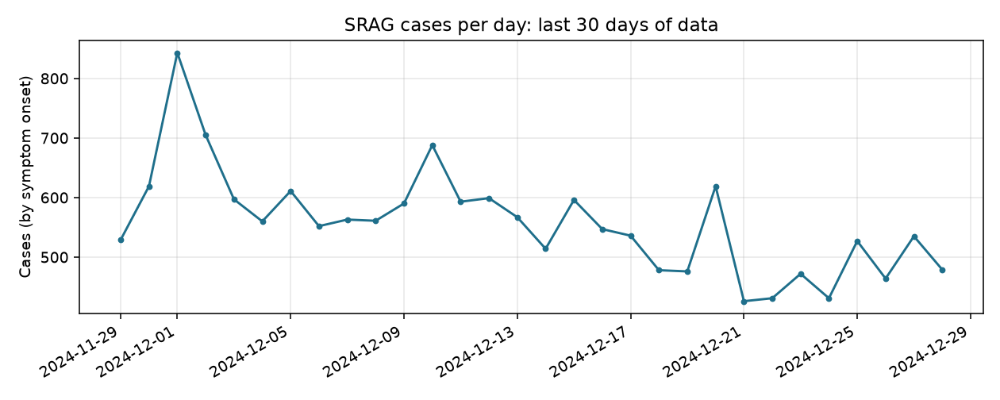
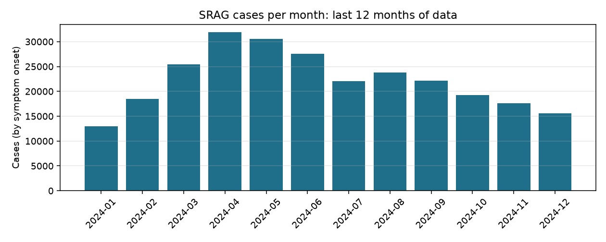

# SRAG Surveillance Report

Data up to **2024-12-28** (all windows are anchored to the latest date in the data). Run `59a12bcdfcaa`.

## Key metrics

| Metric | Value | Numerator / Denominator | Unknown excluded |
|---|---|---|---|
| case_growth_rate | -4.7% | 16708 / 17538 | 0 |
| mortality_rate | 11.6% | 28787 / 248492 | 19494 |
| icu_admission_rate | 31.4% | 74880 / 238306 | 29680 |
| vaccination_rate | 50.3% | 131860 / 262153 | 5833 |

## Charts

## Commentary

In the 30 days to 2024-12-28, notified SRAG cases fell 4.7% compared with the previous 30 days (16708 versus 17538). Recent days are under-counted because of notification lag, which biases this decline downward. Monthly cases peaked at 31875 in April 2024, and the highest daily count was 843. Recent news reports cover rising national cases, alert levels in Sergipe and risk in five states, but this dataset does not verify them.

Over the last 12 months, the in-hospital case fatality rate among cases with known outcome was 11.6% (28787 of 248492, with 19494 excluded). The ICU admission share was 31.4% (74880 of 238306), and the COVID-19 vaccinated share was 50.3% (131860 of 262153). Both the ICU and vaccination figures are proxies: ICU occupancy requires bed capacity data, and population coverage requires a population denominator. These rates describe notified SRAG cases, not the general population.

## Recent news

- Casos de síndrome respiratória aguda grave crescem no país: Agência Brasil (Thu, 05 Nov 2026 21:04:00 GMT)
- Casos de Síndrome Respiratória Aguda Grave em Sergipe estão em nível de alerta, aponta InfoGripe: G1 (Thu, 05 Nov 2026 19:31:03 GMT)
- Cinco estados do Brasil estão em nível de risco para síndrome respiratória: CNN Brasil (Fri, 30 Oct 2026 20:35:16 GMT)
- Síndrome Respiratória Aguda Grave é responsável por 70% das mortes de idosos em Goiás: Goias.GOV (Thu, 23 Apr 2026 07:00:00 GMT)
- DF registra mais de 1,4 mil casos de síndrome respiratória grave no ano: Agência Brasília (Mon, 20 Apr 2026 07:00:00 GMT)

## Metric definitions and limitations

- **case_growth_rate**: (cases in last 30 days - cases in the previous 30 days) / previous 30 days. _Recent days are under-counted because of notification lag, which biases the growth rate downward. Cases are dated by symptom onset (notification date if absent)._
- **mortality_rate**: deaths (EVOLUCAO 2 or 3) / cases with known outcome, last 12 months. _In-hospital case fatality among notified SRAG cases, not population mortality. Cases still open or with unknown outcome are excluded, which can bias the rate._
- **icu_admission_rate**: cases admitted to ICU (UTI=1) / cases with known ICU field, last 12 months. _PROXY. True ICU occupancy needs bed capacity, which this dataset does not contain. This is the share of notified SRAG hospitalisations that required ICU._
- **vaccination_rate**: cases that received a COVID-19 vaccine (VACINA_COV=1) / cases with known vaccination field, last 12 months. _PROXY. True population coverage needs a population denominator, absent here. This is the vaccinated share among notified SRAG cases, not among the population._

---

_This report is generated automatically from public DATASUS data for informational purposes only. It is not medical advice and must not be used for diagnosis or treatment. ICU and vaccination figures are proxies (see definitions)._
